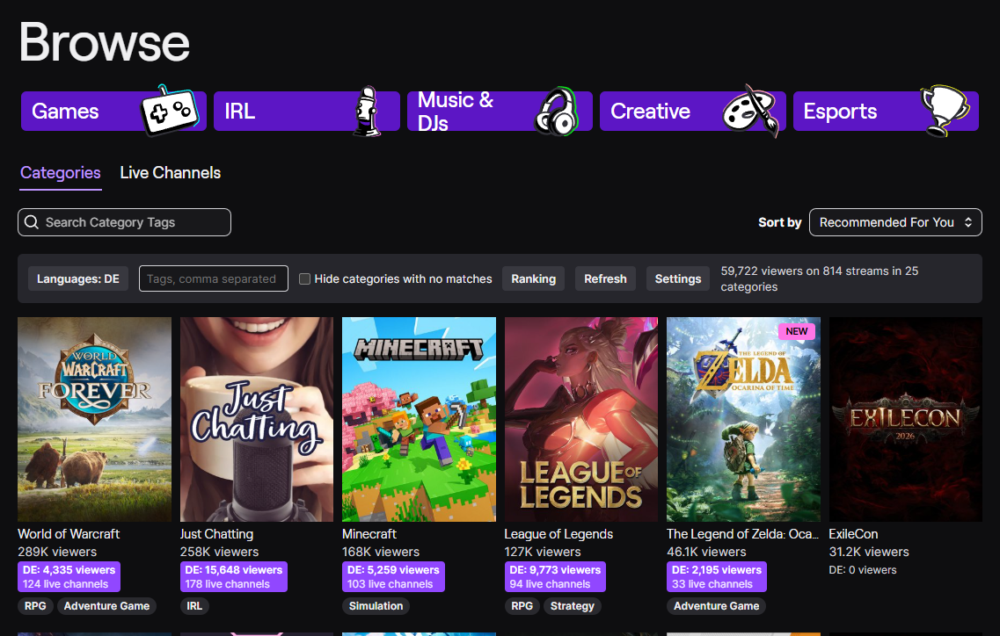
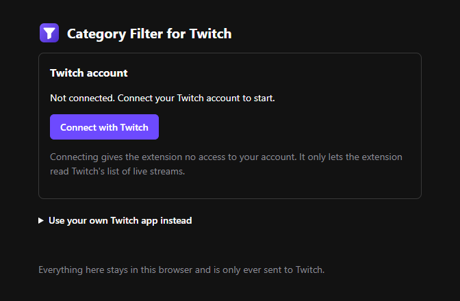
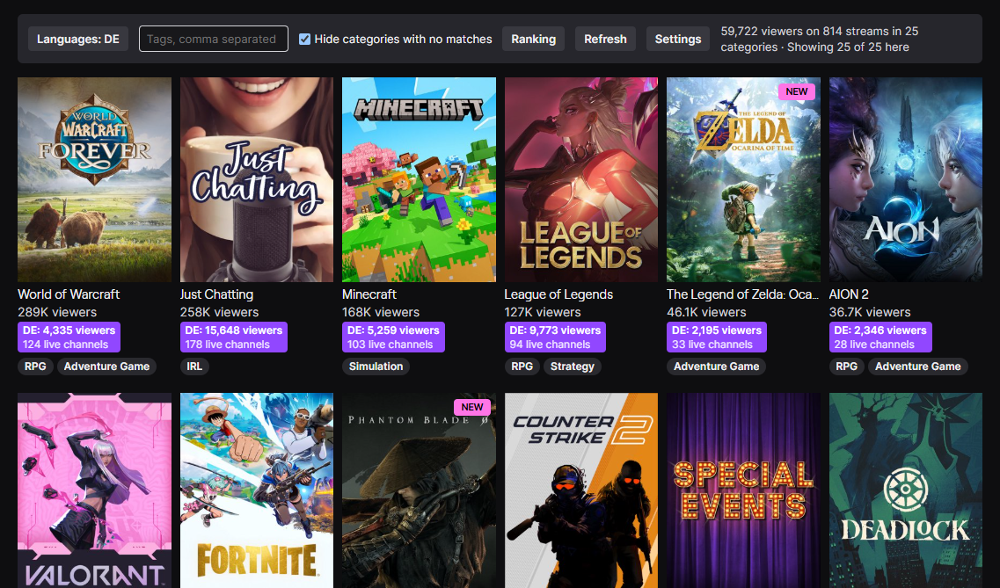
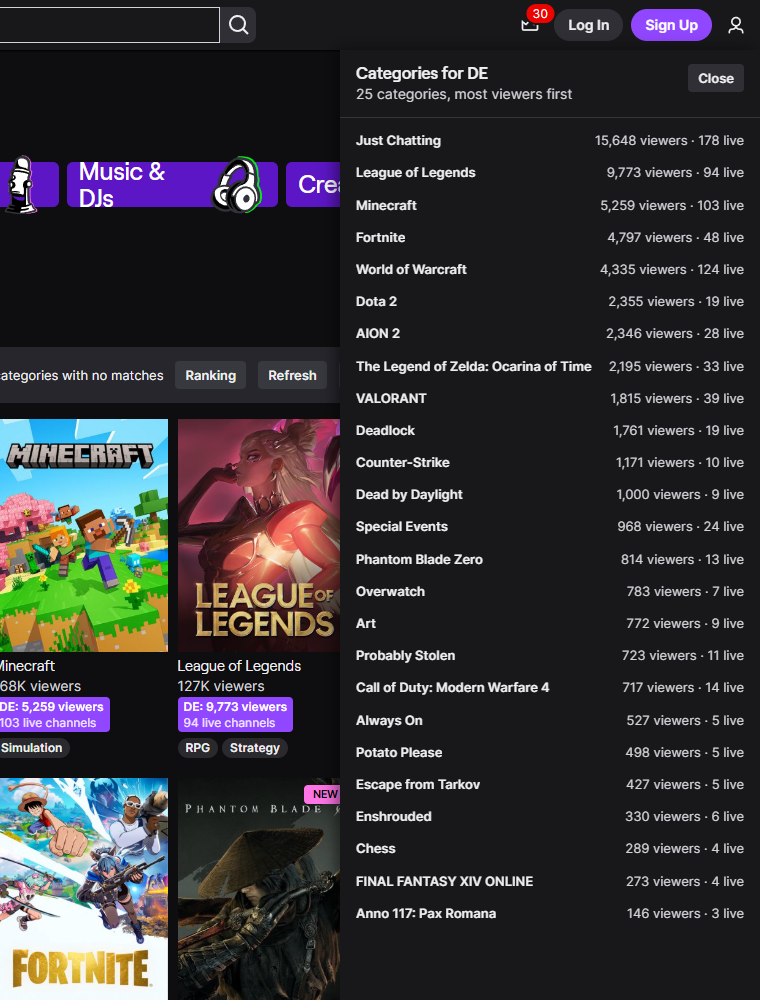

<div align="center">


# Category Filter for Twitch

**See which games a language community is playing on Twitch right now.**

[](https://github.com/MIASock/TwitchFilter/releases/latest)
[](LICENSE)
[](https://github.com/MIASock/TwitchFilter/actions/workflows/build.yml)
[](eslint.config.js)
[](https://github.com/MIASock/TwitchFilter/releases)

[](#chrome-edge-and-brave)
[](#firefox)

</div>

Twitch's browse page counts every viewer worldwide. A category can show 294 viewers and still have no German streams at all. This browser extension adds a second count to every category card, covering only the streams that match your filter.

<p align="center">
  
</p>

> [!IMPORTANT]
> **No affiliation**
>
> Category Filter for Twitch is an independent, unofficial project. It isn't made by, endorsed by or affiliated with Twitch Interactive, Inc. or Amazon.
>
> **Trademarks**
>
> "Twitch" and related names, marks and logos are trademarks of Twitch Interactive, Inc. The name is used only to say which site the extension works with.
>
> **Limitation of liability**
>
> The extension is provided "as is", without warranty of any kind, and you use it at your own risk. See the [license](LICENSE) for the full terms.

## Contents

- [Features](#features)
- [Download](#download)
  - [Chrome, Edge and Brave](#chrome-edge-and-brave)
  - [Firefox](#firefox)
- [Setup](#setup)
- [Usage](#usage)
- [How it works](#how-it-works)
- [Privacy](#privacy)
- [Dev](#dev)
- [Build](#build)
- [Tests](#tests)
- [Release](#release)
- [License](#license)
- [FAQ](#faq)

## Features

- **Filtered counts on every card**, next to Twitch's own: the viewers and live channels that match your languages and tags.
- **Hide categories with no matches**, so the browse page lists only what your community is actually streaming.
- **Ranking**: every matching category, most viewers first, with its top channels one click away.
- **Your browser's language by default**, with every stream language Twitch supports to choose from.
- **Light on Twitch's API**: results are reused for 3 minutes, shared between tabs, and background tabs don't start scans.
- **No server, no tracking**: the extension talks to Twitch and nothing else.

## Download

The extension isn't in the Chrome Web Store or on addons.mozilla.org yet. Until it is, install it from the [latest release](https://github.com/MIASock/TwitchFilter/releases/latest).

### Chrome, Edge and Brave

1. Download `category-filter-for-twitch-<version>-chrome.zip` and unzip it.
2. Open `chrome://extensions` (`edge://extensions` in Edge) and turn on **Developer mode**.
3. Click **Load unpacked** and pick the unzipped folder.

Any Chromium browser from version 111 works.

### Firefox

1. Download `category-filter-for-twitch-<version>-firefox.zip`.
2. Open `about:debugging#/runtime/this-firefox` and click **Load Temporary Add-on**.
3. Pick the zip.

Needs Firefox 140 or later. Firefox removes temporary add-ons when it closes, so you'll have to load it again after a restart.

## Setup

Twitch only shares its live stream list with apps a Twitch user has connected, so the extension needs you to connect your account once.



1. The extension's options open by themselves after you install it. To open them later, click the extension's icon in the toolbar, or **Settings** in the filter bar on twitch.tv.
2. Click **Connect with Twitch**. A Twitch tab opens with a code already filled in.
3. Check that the code matches the one in the options, and click **Authorize**.

That's it. The connection gives the extension no access to your account: it asks for no permissions and can only read public data, like the list of live streams. You can disconnect in the options at any time, or under **Connections** in your Twitch settings.

<br clear="right">

<details>
<summary>Using your own Twitch app instead</summary>

Developers can use an app of their own instead of connecting through the extension's app.

1. In the [Twitch developer console](https://dev.twitch.tv/console/apps), register an app with the redirect URL `http://localhost` and the client type **Confidential**. The console requires two-factor authentication on your account.
2. Copy its **Client ID**, click **New Secret** and copy the **Client Secret**.
3. In the extension's options, open **Use your own Twitch app instead**, paste both and click **Save and test**.

</details>

## Usage

Open [twitch.tv/directory](https://www.twitch.tv/directory). The filter bar appears above the categories. Pick a language or a tag, and each card shows its matching viewers and channels. The languages start as your browser's language, or empty if your browser is in English.

| Control | What it does |
| --- | --- |
| **Languages** | Picks the stream languages to count. |
| **Tags** | Counts only streams with at least one of these tags, separated by commas. |
| **Hide categories with no matches** | Removes every category where nobody matches, once a scan has finished. |
| **Ranking** | Lists all matching categories, most viewers first. Open one to see its channels. |
| **Refresh** | Scans again right away instead of waiting for the next refresh, which comes every 5 minutes. |
| **Settings** | Opens the extension's options, where you connect your Twitch account. |

Click the count on any card to jump to that category in the Ranking.

<p align="center">
  
</p>

<p align="center">
  
</p>

<sub>Screenshots use sample numbers.</sub>

## How it works

Twitch's API can't give a filtered count per category, but it can list every live stream in a language. The extension reads that list page by page and adds it up per category. It then matches the totals to the cards using the category ID in each card's image address, which keeps working when Twitch shows translated category names.

Each request returns up to 100 streams, so a smaller language takes a handful of requests and is done in seconds.

## Privacy

The extension sends nothing to its developer or to anyone besides Twitch. Your Twitch tokens stay in your browser, out of reach of the part of the extension that runs on twitch.tv, and are only ever sent to Twitch. The [privacy policy](PRIVACY.md) covers what's stored and where it goes.

## Dev

```bash
git clone https://github.com/MIASock/TwitchFilter
cd TwitchFilter
npm ci
```

Needs [Node.js](https://nodejs.org) 22.2 or later. To try a change, load the `extension` folder unpacked in a Chromium browser, or [build](#build) and load `dist/firefox/manifest.json` as a temporary add-on in Firefox.

| Path | What's in it |
| --- | --- |
| `extension/` | The extension, shared by both browsers. Its `manifest.json` is the Chromium manifest. |
| `extension/src/core.js` | Filtering, per-category totals, and matching cards to categories. No browser APIs, so it's tested in Node. |
| `extension/src/helix.js` | Twitch client: signing in, tokens, paging, retries and rate limits. |
| `extension/src/background.js` | Keeps the Twitch tokens fresh and runs scans for the open tabs. |
| `extension/src/options.js` | The options page: connecting and disconnecting a Twitch account. |
| `extension/src/secrets.js` | Token storage that content scripts can't read. |
| `extension/src/content.js` | The filter bar, card counts, hiding and the Ranking on twitch.tv. |
| `extension/src/page.js` | Runs in Twitch's own page to ask it for more cards while hiding. |
| `scripts/build.js` | Builds both browsers' folders and zips. |
| `assets/` | The icon source and the README screenshots. |
| `store/` | Store listing images and text for the Chrome, Edge and Firefox stores. |

## Build

```bash
npm run build
```

Writes `dist/chrome` and `dist/firefox`, with a Firefox manifest, plus a zip of each, ready for the stores. The same source always gives byte-identical zips. The build stops if `package.json` and `extension/manifest.json` disagree on the version.

## Tests

```bash
npm test
```

Runs the unit tests for the filtering, the Twitch API client and the build, with Node's built-in test runner.

```bash
npm run check
```

Runs everything CI runs: ESLint, the tests, the build, and Mozilla's add-on linter on the Firefox build.

## Release

1. Raise `version` in both `extension/manifest.json` and `package.json`.
2. Commit, then tag the commit and push the tag:

```bash
git tag v0.2.0
```

```bash
git push origin v0.2.0
```

The [Build workflow](.github/workflows/build.yml) runs every check and publishes a GitHub release with both zips attached. Every other push and pull request runs the same checks and keeps the zips as a workflow artifact.

To publish in the stores, upload the release's zips with the images and text in [`store/`](store/README.md).

## License

MIT © [MIASock](https://github.com/MIASock)

## FAQ

### Why do I have to connect my Twitch account?

Twitch only answers API requests from an app, on behalf of a user who connected it. Connecting through your account keeps the extension serverless: your browser talks to Twitch directly, and nothing passes through anyone else.

### What can the extension do with my account?

Nothing beyond reading public data. It asks Twitch for no permissions, so it can't see your follows, whispers or email, and it can't chat, follow or change anything.

### Why does it ask me to connect again?

Twitch ends the connection after 30 days without use, or when you change your password or disconnect the extension in your Twitch settings. Connecting again takes two clicks.

### Will this get me rate limited?

Twitch limits requests per user, so your scans never compete with anyone else's. The limit is usually 800 requests a minute, and a scan costs one request per 100 matching streams. The extension pauses when it gets close to the limit, reuses a result for 3 minutes, shares one scan between all open tabs, and doesn't start scans in background tabs.

### Why does a stream count under the wrong language?

The language is whatever the streamer picked in their stream settings, so a mislabelled stream counts under the language it's labelled with.

### Why does the filter bar say some streams may be missing?

A scan stops at 60,000 streams. That only happens with English, or with a tag filter and no language, which has to go through all of Twitch. The small channels at the end of the list are the ones left out.

### Why aren't all matching categories shown while hiding?

While hiding, the browse page loads up to about 1,000 categories. If more categories match, the filter bar tells you how many aren't shown. Ranking always lists them all, up to 300.

### The counts disappeared after a Twitch update. What now?

The extension depends on how Twitch builds its category cards, and loading more cards while hiding uses an internal Twitch function. A Twitch redesign can break either until the extension is updated. If only the loading breaks, Ranking still lists everything. Please [open an issue](https://github.com/MIASock/TwitchFilter/issues) if you spot it first.
